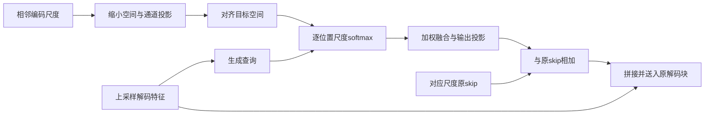

# 模块二本机实现与修改记录

日期：2026-11-03。用户要求先在本机编码，租好服务器后再训练；本次没有连接服务器或开展完整训练。

## 首版设计

模块名为多尺度自适应跳跃融合。设编码尺度从细到粗为`e[0]…e[K-1]`，瓶颈为`e[K]`；每个解码层目标尺度为i，原上采样解码特征为u_i，原skip为e_i。

- 来源集合`S_i={i-1,i,i+1}∩[0,K-1]`，端点两个、中间三个尺度；不把瓶颈作为skip来源，瓶颈仍通过原解码主干进入u_i。
- 每个源先平均池化缩小超出目标尺寸的轴，再用1×1卷积投影到`r_i=min(16,C_i)`通道，最后双/三线性插值到目标尺寸，`align_corners=False`。所有尺寸按真实张量读取，支持各向异性和非等比尺度。
- 记对齐后的源为v_s；查询`q=Conv1×1(u_i)`，键`k_s=Conv1×1(v_s)`。逐位置打分`score_s=sum_channels(q*k_s)/sqrt(r_i)`；`alpha=softmax(score, dim=来源尺度)`。
- 融合`v=sum_s(alpha_s*v_s)`；新的skip为`e_i+W_out(v)`，再与u_i拼接，送入原残差解码块。权重形状为`[B,|S_i|,*spatial_i]`，确有跨尺度依赖；不是独立的通道/空间门控。
- `W_out`零初始化，初始skip严格等于原skip；首步先更新输出投影，打开后梯度再进入投影及打分分支。不能把首步源分支零梯度误判为永久断路。
- AMP下打分、softmax和加权累积使用FP32；不堆叠所有源的通道体积。新增参数和激活仍有成本，不能以压缩宽度替代真实GPU内存测量。

这是本项目首版可检验实现，尚未通过结果证明优越性，也没有在本次工作中完成文献新颖性核查。

## 配置与兼容性

| 配置 | Trainer | 主体与损失 |
|---|---|---|
| D | `nnUNetTrainerMambaUNetMultiScaleSkip` | A+模块二，原分割损失，无边界头 |
| E | `nnUNetTrainerMambaUNetBGMultiScaleSkip` | C+相同模块二，保留C边界监督/注入及0.1辅助权重 |

复用原编码器、12个TransMamba层、转置卷积、残差解码块、分割头和深监督输出顺序。原A/F/C/F-aux源码未改；MHA轴和训练协议未改。D/E以后均从头训练，不默认加载旧权重微调。训练关闭compile并拒绝DDP，保持原MHA的单卡batch交互约束。

每个Trainer写入`stage3_config.json`；E另保留继承C的`stage2_config.json`说明模块一配置。检查点记录独立Trainer名，原推理器能自动重建D/E；不改推理权重选择逻辑。

## 文件清单

| 文件（相对内层项目） | 用途 |
|---|---|
| `umamba/nnunetv2/nets/multiscale_skip_fusion.py` | 对齐、动态尺度权重及解码器接入 |
| `umamba/nnunetv2/nets/MambaUNetSkipFusion.py` | D/E工厂，避免重复初始化原网络 |
| `umamba/nnunetv2/training/nnUNetTrainer/nnUNetTrainerMambaUNetSkipFusion.py` | 独立Trainer、配置与E原辅助loss继承 |
| `scripts/run_stage3.py` | 独立种子/目录、协议校验、源码哈希、日志和续训入口；沿用阶段二已验证流程，冻结旧脚本 |
| `scripts/check_stage3_framework.py` | 合成数据真实nnU-Net训练/验证及预测器权重重载，Mamba显式替身 |
| `umamba/nnunetv2/tests/unit_tests/test_multiscale_skip_fusion.py` | 跨尺度、梯度、初始化、混合精度和运行入口检查 |

## 本机验证与边界

- 新增7项测试通过：2D/3D奇数尺寸、softmax归一化、严格初始恒等、首次更新后的跨尺度/查询梯度、改变邻居及解码context的实际影响、BF16反传、state_dict重载和D/E目录隔离等。
- 真实nnU-Net编码器/解码器/Trainer/损失及预测器，D/E×2D/3D四种合成配置均通过：初始解码器与原路径逐元素一致、一次优化更新、训练/验证有限、深监督接口、best/final写盘、预测器自动重建及输出一致、请求不存在权重时报错。
- 框架使用显式CPU Mamba替身，未模拟CUDA selective scan的正确性。合成patch的参数量不代表正式CT参数量。
- 本机原始控制台、合成权重和测试日志在`output/stage3_framework_check_20261103/`；小型报告随本目录的`validation/`保存。
- 首次全套回归受Windows沙箱临时目录ACL限制，正常权限下重试；最终情况以`validation/local_validation.json`为准。
- 全套回归共128项，127项通过、1项跳过；跳过的是依赖Linux文件锁的既有F-aux后台流程测试，本机Windows不支持。没有模块二测试失败。
- 完整CT patch与batch2的真实CUDA/AMP、峰值显存、效率和DSC/NSD留待服务器验收；当前没有新增临床分割结果。

下一步等待服务器就绪，先运行真实CUDA短程，再按原协议进行D的完整实验；E入口已经提供，正式排程仍在D之后。
