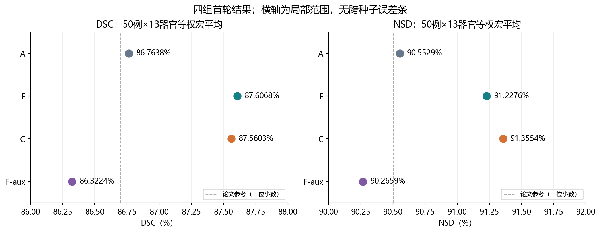
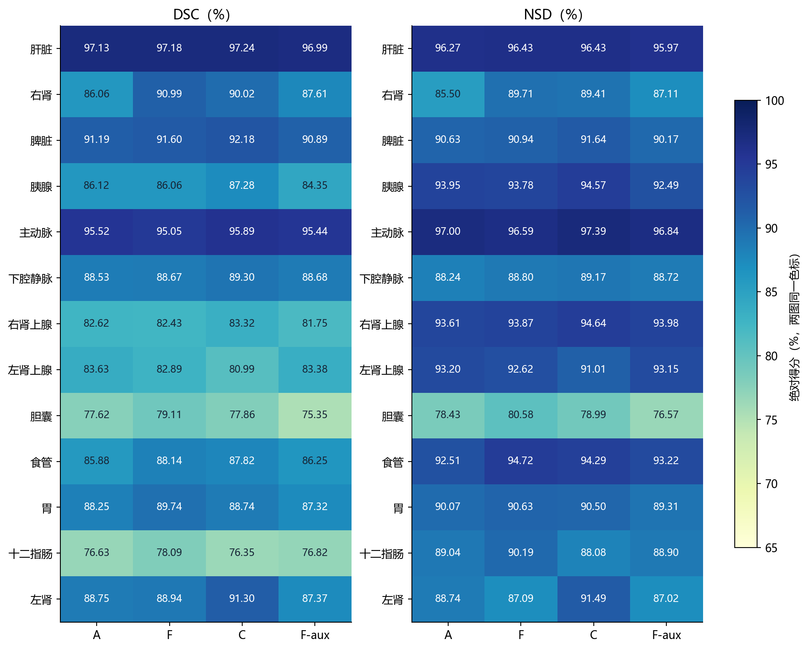
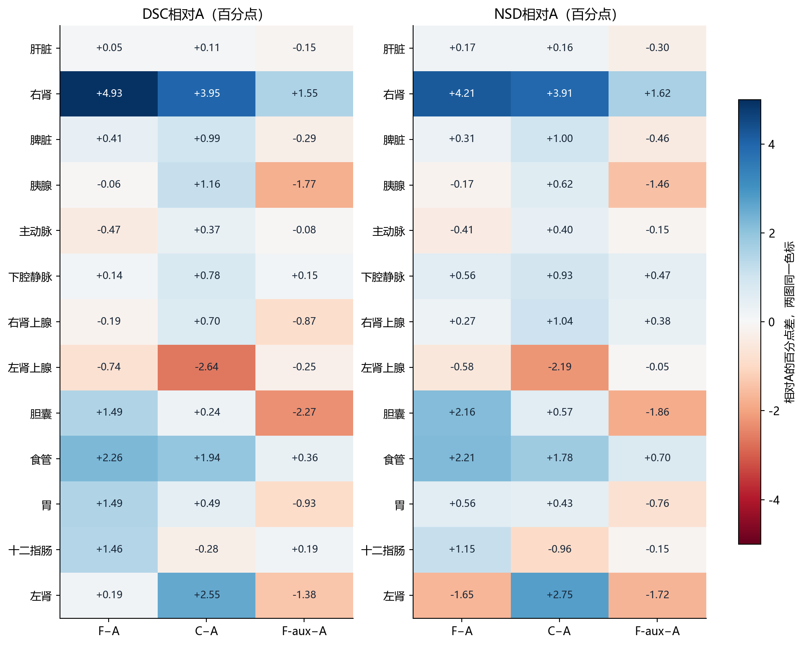
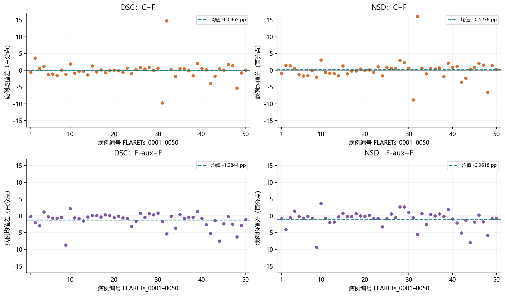
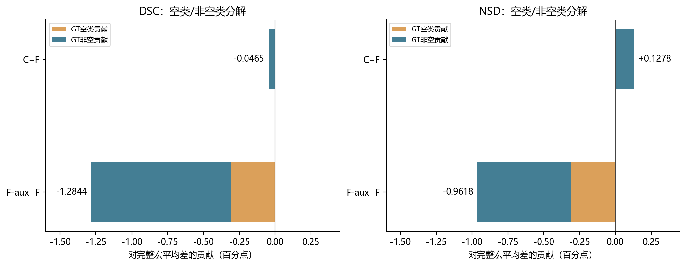

# 阶段二实验总结与A/F/C/F-aux四组消融对比

报告日期：2026-10-31；实验数据截至2026-10-30。研究任务：模块一BG-Block-AttnRes实现与验证。数据：Dataset701_AbdomenCT，相同外部50例、13器官。

**阶段二已完成实现、真实数据验收、F/C/F-aux各一轮完整训练与统一外部评价，形成了可追溯的首轮消融结果。当前最明确的现象是F、C高于已有A，F的DSC最高、C的NSD最高；C对F的附加收益尚不明确，F-aux本轮下降。稳定性与机制归因尚未完成，当前仍在阶段二2.5。**

## 1. 如何阅读这次对比

| 配置 | 深度聚合 | 边界辅助监督 | 边界引导注入 | 推理边界头 |
|---|---|---|---|---|
| A | 原基线 | 无 | 无 | 无 |
| F | 有 | 无 | 无 | 无 |
| C | 有 | 有，0.1 | 有 | 执行 |
| F-aux | 有，与F相同 | 有，与C相同 | 无 | 跳过 |

F−A观察基础深度聚合；F-aux−F观察辅助监督；C−F-aux观察在辅助监督基础上的注入增量；C−F是监督与注入的组合差异。F-aux从头训练，不能用训练好的C在推理时关闭引导替代。所有组保留原MHA实现规则；这不意味着MHA权重或数值输出在各组相同。

## 2. 评价口径与可比性

原始8份CSV均保留，按病例ID和13器官列对齐，未删低分病例。主指标为650个病例–器官对等权平均；单位为%，相减的单位是百分点（pp）。原CSV已四舍五入至四位小数，因此这里是对已保存指标复算。

F/C/F-aux均1000轮、seed1234、fold_all/3d_fullres、物理batch2、patch[40,224,192]、初始lr0.01，组大小3，边界头隐藏通道8。统一best选择规则，F及F-aux取第1000轮best，C取第994轮best；不按外部50例重选权重。无TTA、滑窗0.5、Gaussian、单patch前向，预处理/导出各1进程，NSD两进程，无新增后处理。

A为实验室自行训练后迁移评估的复现基线；F从4090第500轮迁至V100续训，C/F-aux在V100从头训练。不能宣称硬件和增强轨迹完全一致；A能否计入匹配种子重复实验还需核对其记录。fold_all的在线验证复用训练病例，不是独立开发集，其Dice/损失不能代替外部评价或泛化验证。

A导出历史为49例原导出、0050低内存补丁；F/C/F-aux统一使用独立runtime中的等价低内存补丁，保留已有验证范围。DSC/NSD沿用同一空类规则、NSD逐器官容差及Aorta/IVC/Esophagus的GT z范围裁剪。论文86.7%/90.5%仅作为原表参考，不构成同次受控实验。

## 3. 总体数据对比

| 来源/组别 | DSC % | NSD % |
|---|---:|---:|
| 论文Hetero-UNet参考 | 86.7 | 90.5 |
| A | 86.7638 | 90.5529 |
| F | 87.6068 | 91.2276 |
| C | 87.5603 | 91.3554 |
| F-aux | 86.3224 | 90.2659 |

*图1：四组宏平均。点图使用明确的局部横轴；没有跨种子误差条，因为目前未完成重复种子实验。*

| 比较 | DSC差 pp | NSD差 pp |
|---|---:|---:|
| F−A | +0.8430 | +0.6747 |
| C−A | +0.7965 | +0.8025 |
| F-aux−A | -0.4414 | -0.2870 |
| F-aux−F | -1.2844 | -0.9618 |
| C−F-aux | +1.2380 | +1.0896 |
| C−F | -0.0465 | +0.1278 |

## 4. 全部13器官对比

### DSC（%）

| 器官 | A | F | C | F-aux |
|---|---:|---:|---:|---:|
| 肝脏 Liver | 97.1338 | 97.1826 | 97.2402 | 96.9858 |
| 右肾 RK | 86.0614 | 90.9870 | 90.0160 | 87.6070 |
| 脾脏 Spleen | 91.1866 | 91.5990 | 92.1770 | 90.8930 |
| 胰腺 Pancreas | 86.1214 | 86.0648 | 87.2834 | 84.3506 |
| 主动脉 Aorta | 95.5174 | 95.0490 | 95.8852 | 95.4404 |
| 下腔静脉 IVC | 88.5250 | 88.6670 | 89.3014 | 88.6750 |
| 右肾上腺 RAG | 82.6196 | 82.4280 | 83.3158 | 81.7542 |
| 左肾上腺 LAG | 83.6288 | 82.8866 | 80.9890 | 83.3762 |
| 胆囊 Gallbladder | 77.6228 | 79.1098 | 77.8648 | 75.3524 |
| 食管 Esophagus | 85.8838 | 88.1438 | 87.8224 | 86.2458 |
| 胃 Stomach | 88.2514 | 89.7428 | 88.7412 | 87.3238 |
| 十二指肠 Duodenum | 76.6286 | 78.0904 | 76.3482 | 76.8156 |
| 左肾 LK | 88.7488 | 88.9378 | 91.2998 | 87.3710 |

### NSD（%）

| 器官 | A | F | C | F-aux |
|---|---:|---:|---:|---:|
| 肝脏 Liver | 96.2652 | 96.4322 | 96.4278 | 95.9654 |
| 右肾 RK | 85.4970 | 89.7104 | 89.4066 | 87.1146 |
| 脾脏 Spleen | 90.6330 | 90.9406 | 91.6352 | 90.1726 |
| 胰腺 Pancreas | 93.9518 | 93.7770 | 94.5684 | 92.4948 |
| 主动脉 Aorta | 96.9970 | 96.5900 | 97.3928 | 96.8446 |
| 下腔静脉 IVC | 88.2424 | 88.8044 | 89.1750 | 88.7160 |
| 右肾上腺 RAG | 93.6058 | 93.8712 | 94.6412 | 93.9822 |
| 左肾上腺 LAG | 93.1998 | 92.6184 | 91.0062 | 93.1498 |
| 胆囊 Gallbladder | 78.4286 | 80.5838 | 78.9946 | 76.5672 |
| 食管 Esophagus | 92.5134 | 94.7212 | 94.2938 | 93.2182 |
| 胃 Stomach | 90.0728 | 90.6280 | 90.5030 | 89.3132 |
| 十二指肠 Duodenum | 89.0438 | 90.1928 | 88.0846 | 88.8974 |
| 左肾 LK | 88.7374 | 87.0894 | 91.4916 | 87.0204 |

*图2：逐器官绝对得分，DSC与NSD使用同一65–100色标。*

*图3：逐器官相对A差值。两图使用同一对称色标，正值为改善。*

### C相对F的器官差异

DSC：7个器官均值升、6个降。改善最多：左肾 +2.3620 pp、胰腺 +1.2186 pp、右肾上腺 +0.8878 pp；下降最多：左肾上腺 -1.8976 pp、十二指肠 -1.7422 pp、胆囊 -1.2450 pp。
NSD：6个器官均值升、7个降。改善最多：左肾 +4.4022 pp、主动脉 +0.8028 pp、胰腺 +0.7914 pp；下降最多：十二指肠 -2.1082 pp、左肾上腺 -1.6122 pp、胆囊 -1.5892 pp。

这些是组均值层面的器官方向，不代表每个病例均改善。边界引导的作用不应只由总体均值判断，也不能由少数器官改善推断普遍收益。

## 5. 全部50例配对分析

| 指标/比较 | 均值差 pp | 中位数差 pp | 升/降/平病例数 |
|---|---:|---:|---:|
| DSC F−A | +0.8430 | +0.8558 | 36/14/0 |
| DSC C−A | +0.7965 | +0.8754 | 35/15/0 |
| DSC F-aux−A | -0.4414 | -0.0504 | 24/26/0 |
| DSC F-aux−F | -1.2844 | -0.5962 | 12/38/0 |
| DSC C−F-aux | +1.2380 | +0.5369 | 33/17/0 |
| DSC C−F | -0.0465 | +0.0373 | 27/23/0 |
| NSD F−A | +0.6747 | +0.5962 | 35/15/0 |
| NSD C−A | +0.8025 | +0.6762 | 35/15/0 |
| NSD F-aux−A | -0.2870 | +0.2754 | 27/23/0 |
| NSD F-aux−F | -0.9618 | -0.5292 | 14/36/0 |
| NSD C−F-aux | +1.0896 | +0.3062 | 31/19/0 |
| NSD C−F | +0.1278 | +0.3577 | 28/22/0 |

*图4：每个点为同一病例13器官均值的配对差；正值表示左侧组更好。病例不是独立训练重复，不由该图推断跨种子稳定性。*

C−F的DSC为27例升/23例降，中位数差为+0.0373 pp，但均值为−0.0465 pp；NSD为28例升/22例降，中位数差+0.3577 pp。均值接近并不等于所有病例都没有变化，少数幅度较大的病例可以影响总体方向。F-aux−F的下降则出现在多数病例。

病例差反映效应不均匀。F-aux−F下降最多的五例为：FLARETs_0009 -8.7323 pp、FLARETs_0044 -7.5238 pp、FLARETs_0048 -6.2815 pp、FLARETs_0032 -5.3546 pp、FLARETs_0042 -5.2715 pp。这些病例用于诊断时应说明选择依据，不因低分而从主结果中删除。

## 6. GT空类与非空类分层

| 组别 | 空类正确/错误对（共19） | 非空DSC %（631对） | 非空NSD %（631对） |
|---|---:|---:|---:|
| A | 12/7 | 87.4746 | 91.3778 |
| F | 11/8 | 88.5015 | 92.2313 |
| C | 11/8 | 88.4536 | 92.3630 |
| F-aux | 9/10 | 87.4953 | 91.5576 |

F-aux比F/C多2个空类错误计分对，对完整宏平均的净贡献为−0.3077 pp；F-aux−F其余DSC下降约−0.9768 pp、NSD约−0.6541 pp来自GT非空对。F与C空类得分合计相同，因此C−F净差完全来自GT非空对。

与A相比，F-aux在GT非空对上DSC略高约0.0207 pp、NSD高约0.1797 pp，但空类错误计分对更多，完整宏平均仍低于A。这个分解解释计分构成，不意味着F-aux已达到稳定改善。GT为空不等同器官解剖学不存在；分层仅作补充，不能替换完整50例主指标。

*图5：完整宏平均差值的空类/非空类加权分解；不是把两个分层均值直接相加。*

## 7. 阶段二实验总结与消融结论

| 任务 | 已取得证据 | 当前判断 |
|---|---|---|
| 2.1基础深度聚合 | 代码/梯度检查、真实数据验收及F完整训练评价 | 工程实现完成；F相对A有首轮提升，待重复确认 |
| 2.2边界头与引导 | C完整训练、边界图/池化引导/权重干预 | 分支参与计算，但是否带来稳定净增益仍未确认 |
| 2.3组装与运行 | 完整batch/patch CUDA/AMP、独立Trainer、权重加载和导出 | 运行链路完成，未改MHA |
| 2.4首轮统一评价 | A/F/C/F-aux同50例DSC/NSD、逐器官和逐病例 | 首轮数据齐全；不是多种子稳定性验收 |
| 2.5归因与确认 | F-aux从头训练，监督/注入控制对照已补齐 | 首轮消融完成；重复实验与机制解释仍待完成 |

**可以表述的总体结果**：在当前冻结基座和本轮设置下，新增深度聚合的F及完整C均高于已有A；C对F总体表现为DSC略低、NSD略高。相同0.1辅助监督但无注入的F-aux低于F；C相对F-aux更好，提示本轮辅助监督与条件注入的组合行为需要分开研究。

**尚不能表述的结论**：不能说边界监督必然有害、边界注入已证明稳定有效、模块一已全面胜出，或将C−F-aux直接当作可推广的因果效应。F-aux差于F不等于边界标签、损失或池化一定存在代码错误；同样，C与F接近也不证明引导完全无效。

### 与已完成诊断怎样对应

10月29日的五个C诊断patch中，重复前向一致；置零引导会改变深度权重及部分标签，说明引导路径在这些输入上生效。变化主要集中在最后聚合器。高分辨率边界概率>0.5约占1.82%–6.08%，最大池化后对应高引导token约占74.76%–93.81%，提示空间选择性可能减弱，但尚不是性能原因的证明。五例GT定位patch不是无偏测试集或F-aux训练替代。

F/C全50例错误分层已完成，F-aux尚未做新的全卷逐体素错误分型。训练/验证loss不能直接跨F与含辅助损失的组比较；先拆分segmentation与boundary项，且记住fold_all在线验证复用训练病例。

## 8. 后续建议：先补解释与稳定性，再决定改动

当前建议是保留四组原始结果，先做低成本离线检查，再推进受控的内部开发与关键重复。服务器已执行关机，本报告不启动新训练。

| 优先级 | 工作 | 具体产出/完成条件 |
|---|---|---|
| P0：离线复核 | 拆分F/C/F-aux训练曲线，核对学习率、segmentation/boundary量级和best选择；复核0009/0044/0048等退化例并包含改善对照例 | 统一曲线图、病例/器官错误清单；区分空类FP、GT非空错位/漏分、覆盖过大和轮廓偏差 |
| P1：内部开发诊断 | 固定训练集内部划分；检查边界目标与预测对齐、池化空间选择性、浅层共享特征上的分割/辅助梯度 | 只记录可测的现象，如梯度范数/夹角与引导空间变化，不由宏平均猜原因 |
| P2：关键重复 | 优先补F/C相同种子集合；若论文要主张监督/注入独立贡献，F-aux也纳入匹配重复；A按主计划补匹配基线 | 目标至少3个预先记录种子，报告跨种子均值±标准差；预算不足则明确为探索结果 |
| P3：必要的单因素改进 | 如内部诊断支持，再分别测试较小辅助权重或更保留空间差异的池化；每次只改变一个因素 | 在内部开发集决定新版本，冻结后统一训练相关对照；不把多处修正合算成某个模块收益 |
| P4：模块二与联合模型 | 模块一版本及结论边界记录清楚后，继续原多尺度自适应跳跃融合D，再做联合E | D对A独立验证，E对A/C/D分离联合效应；不把模块二收益倒算给模块一 |

F/C差异较小，所以有限算力优先用于判断它是否可重复。辅助权重0.1及组大小3是首轮固定值，不是已验证最优；若做新超参试验，候选值和内部选择规则应在开跑前登记。现有A可否计入重复集合取决于种子和协议可追溯情况。

外部50例已用于评价和错误诊断，后续应如实说明其使用历史。它不再适合充当反复选择新池化/辅助权重的开发集。条件允许时增加未参与开发的新测试数据或按预设流程交叉验证。保留MHA的决定不变；修正轴布局是独立补充协议，不是当前消融的前置步骤。

## 9. 后续计划与阶段推进

| 顺序 | 工作阶段 | 是否需要新训练 | 进入下一步的依据 |
|---|---|---|---|
| 1 | 完成离线日志和代表病例复核 | 不需要 | 有可追溯的现象清单，明确是否存在实际实现错误 |
| 2 | 固定内部开发划分、登记重复种子与资源预算 | 仅必要的短程/开发实验 | 实验版本、唯一改动、评价口径和选择规则已记录 |
| 3 | 关键组配对重复与必要的监督/注入确认 | 需要，按统一协议 | 判断F/C差异是否稳定；形成模块一可报告版本 |
| 4 | 推进阶段三模块二D及阶段四联合E | 后续独立训练 | 不改A–H定义；模块一负结果和局限一并保留 |

当前阶段是“阶段二首轮实验完成，2.5结果确认未完全完成”。不返回阶段一重做已经核验的全部流程，也不要求在进入模块二前完成所有横向方法和MR实验。完整训练耗时应依据各版本GPU实测重新估计；本轮C约40.57小时、F-aux约39.15小时，不能把它们当作所有后续配置的固定工期。

## 10. 数据表、图和证据位置

主报告为本文件。可复用表格在`output/stage2_summary_20261030/`：`overall.csv`、`paired_comparisons.csv`、`organs_DSC.csv`、`organs_NSD.csv`、`cases_DSC.csv`、`cases_NSD.csv`、`GT_strata.csv`及`all_2600_case_organ_model_records.csv`。CSV百分数和fraction字段已在列名标注；病例间SD不是跨种子SD。

五张图均在`Hetero-UNet/docs/stage2/figures/stage2_20261030/`提供PNG及可编辑SVG。数值及源文件SHA256见`output/stage2_summary_20261030/analysis.json`。原始8份CSV来自本机已核验的F-aux最终记录包，未覆盖原文件。

[F-aux完成核验](Hetero-UNet/docs/stage2/FAUX_COMPLETED_2026-10-30.md)；[F/C错误与引导诊断](Hetero-UNet/docs/stage2/DIAGNOSTICS_2026-10-29.md)；[工作计划](Mamba-Attention医学图像分割_工作计划.md)。原权重、预测及最终记录在本机与OSS的对应四份归档中保留，本报告仅派生汇总。

## 附录：全部50例病例均值

### DSC（每例13器官均值，%）

| 病例 | A | F | C | F-aux |
|---|---:|---:|---:|---:|
| FLARETs_0001 | 87.8992 | 90.9315 | 90.3169 | 90.7523 |
| FLARETs_0002 | 76.1108 | 77.1292 | 80.7469 | 75.0946 |
| FLARETs_0003 | 88.2831 | 90.5554 | 91.0400 | 87.5808 |
| FLARETs_0004 | 90.8115 | 90.5585 | 91.6500 | 91.7508 |
| FLARETs_0005 | 77.7715 | 79.4346 | 78.1177 | 79.1715 |
| FLARETs_0006 | 86.7485 | 91.5815 | 90.4815 | 90.8946 |
| FLARETs_0007 | 89.7000 | 89.8492 | 88.2554 | 89.1138 |
| FLARETs_0008 | 87.0023 | 87.2531 | 87.3308 | 86.7815 |
| FLARETs_0009 | 79.4892 | 83.3823 | 82.1915 | 74.6500 |
| FLARETs_0010 | 91.2785 | 90.5423 | 92.4423 | 92.6900 |
| FLARETs_0011 | 89.7038 | 90.7792 | 89.8977 | 90.1915 |
| FLARETs_0012 | 87.9315 | 88.2077 | 87.8654 | 87.3408 |
| FLARETs_0013 | 92.1600 | 93.1054 | 92.8538 | 91.6177 |
| FLARETs_0014 | 88.5523 | 89.3154 | 87.9546 | 88.9785 |
| FLARETs_0015 | 91.9000 | 90.7377 | 92.0246 | 90.8262 |
| FLARETs_0016 | 89.5246 | 90.9985 | 90.5315 | 91.0654 |
| FLARETs_0017 | 92.7162 | 92.5485 | 92.6669 | 92.2138 |
| FLARETs_0018 | 93.7354 | 93.7308 | 93.0046 | 94.0600 |
| FLARETs_0019 | 87.0685 | 86.3338 | 86.2392 | 86.4300 |
| FLARETs_0020 | 86.1969 | 86.4100 | 86.4562 | 85.8554 |
| FLARETs_0021 | 96.5008 | 96.6323 | 96.4962 | 96.5285 |
| FLARETs_0022 | 90.6723 | 83.6577 | 83.0562 | 83.0531 |
| FLARETs_0023 | 86.9592 | 89.4277 | 90.0454 | 88.6546 |
| FLARETs_0024 | 89.8254 | 90.7100 | 89.7369 | 87.5800 |
| FLARETs_0025 | 84.1069 | 84.8985 | 85.0662 | 83.3231 |
| FLARETs_0026 | 93.8223 | 93.2154 | 93.9646 | 93.9592 |
| FLARETs_0027 | 90.7154 | 91.8469 | 92.2423 | 91.3562 |
| FLARETs_0028 | 93.4415 | 94.2685 | 95.1715 | 94.9215 |
| FLARETs_0029 | 93.5808 | 93.2077 | 93.2138 | 93.5231 |
| FLARETs_0030 | 94.3008 | 93.0069 | 93.6762 | 93.8200 |
| FLARETs_0031 | 92.6554 | 94.8077 | 85.0846 | 93.1069 |
| FLARETs_0032 | 54.4077 | 48.9485 | 63.7346 | 43.5938 |
| FLARETs_0033 | 91.6215 | 84.4400 | 84.6723 | 84.3569 |
| FLARETs_0034 | 86.8538 | 91.3346 | 89.5146 | 87.6369 |
| FLARETs_0035 | 91.7108 | 92.9315 | 93.4000 | 93.3300 |
| FLARETs_0036 | 91.5654 | 93.0115 | 93.4538 | 92.2315 |
| FLARETs_0037 | 86.6969 | 86.4054 | 86.2692 | 85.9615 |
| FLARETs_0038 | 81.0508 | 86.8746 | 85.2323 | 86.4546 |
| FLARETs_0039 | 85.1015 | 86.3200 | 88.3415 | 87.6046 |
| FLARETs_0040 | 86.6023 | 87.2608 | 87.8323 | 86.5592 |
| FLARETs_0041 | 82.6408 | 83.5777 | 83.7192 | 80.9269 |
| FLARETs_0042 | 74.6308 | 80.2131 | 76.2862 | 74.9415 |
| FLARETs_0043 | 87.1792 | 87.4631 | 85.7162 | 86.0054 |
| FLARETs_0044 | 94.4777 | 94.7608 | 95.2215 | 87.2369 |
| FLARETs_0045 | 83.6392 | 88.8277 | 88.8746 | 86.4692 |
| FLARETs_0046 | 80.8815 | 79.1438 | 80.8946 | 78.9638 |
| FLARETs_0047 | 83.7162 | 84.6262 | 85.9592 | 82.1262 |
| FLARETs_0048 | 60.5062 | 67.9577 | 62.6346 | 61.6762 |
| FLARETs_0049 | 86.4669 | 88.1492 | 87.3792 | 85.2638 |
| FLARETs_0050 | 87.2762 | 89.0308 | 89.0592 | 87.8938 |

### NSD（每例13器官均值，%）

| 病例 | A | F | C | F-aux |
|---|---:|---:|---:|---:|
| FLARETs_0001 | 91.3608 | 95.4854 | 94.5269 | 94.6369 |
| FLARETs_0002 | 79.8677 | 82.7238 | 84.2008 | 78.6908 |
| FLARETs_0003 | 93.0046 | 93.5331 | 94.9169 | 93.0062 |
| FLARETs_0004 | 93.9138 | 94.0038 | 94.5838 | 95.4208 |
| FLARETs_0005 | 83.3385 | 85.3146 | 84.0677 | 85.0908 |
| FLARETs_0006 | 89.2600 | 93.3423 | 91.5992 | 92.5908 |
| FLARETs_0007 | 91.9877 | 91.7323 | 90.1669 | 91.5777 |
| FLARETs_0008 | 89.2146 | 89.7008 | 89.6977 | 88.9738 |
| FLARETs_0009 | 87.8608 | 91.4185 | 89.3485 | 82.0400 |
| FLARETs_0010 | 94.9623 | 93.3477 | 96.3769 | 96.9738 |
| FLARETs_0011 | 93.7646 | 95.1146 | 94.4469 | 94.3662 |
| FLARETs_0012 | 88.5515 | 89.5308 | 88.5923 | 87.5323 |
| FLARETs_0013 | 96.1446 | 97.6192 | 96.6362 | 95.7992 |
| FLARETs_0014 | 93.3631 | 93.8623 | 92.2315 | 93.6146 |
| FLARETs_0015 | 97.4838 | 96.0762 | 97.4023 | 96.8746 |
| FLARETs_0016 | 93.7777 | 95.3969 | 94.3408 | 95.1946 |
| FLARETs_0017 | 96.1362 | 96.2562 | 96.0769 | 96.0615 |
| FLARETs_0018 | 96.6892 | 96.7331 | 96.5446 | 97.3469 |
| FLARETs_0019 | 93.0254 | 92.0038 | 92.4038 | 91.9723 |
| FLARETs_0020 | 89.8677 | 90.2146 | 90.1654 | 90.1669 |
| FLARETs_0021 | 99.5592 | 99.2969 | 99.3846 | 99.4831 |
| FLARETs_0022 | 95.5415 | 88.6446 | 88.0762 | 87.8400 |
| FLARETs_0023 | 89.2669 | 91.0600 | 92.1215 | 90.3585 |
| FLARETs_0024 | 93.0431 | 94.3015 | 92.6500 | 91.0023 |
| FLARETs_0025 | 85.8923 | 87.3715 | 88.2431 | 86.5215 |
| FLARETs_0026 | 98.4415 | 97.6815 | 98.2308 | 98.2708 |
| FLARETs_0027 | 95.6715 | 96.8677 | 97.3946 | 96.3362 |
| FLARETs_0028 | 95.6931 | 95.8500 | 98.8615 | 98.5223 |
| FLARETs_0029 | 97.5608 | 94.8700 | 97.1738 | 97.5292 |
| FLARETs_0030 | 98.6377 | 96.9854 | 97.6462 | 98.0262 |
| FLARETs_0031 | 94.3538 | 95.8277 | 86.9715 | 95.3162 |
| FLARETs_0032 | 55.1500 | 49.6231 | 65.6538 | 44.1215 |
| FLARETs_0033 | 96.7362 | 89.1846 | 89.7954 | 89.8315 |
| FLARETs_0034 | 91.8577 | 95.3146 | 94.2331 | 92.7638 |
| FLARETs_0035 | 96.8754 | 97.6362 | 98.1731 | 98.0700 |
| FLARETs_0036 | 95.0031 | 96.4185 | 96.7877 | 96.4038 |
| FLARETs_0037 | 91.0992 | 90.8746 | 91.5969 | 91.4685 |
| FLARETs_0038 | 85.9908 | 92.2123 | 90.2992 | 91.9854 |
| FLARETs_0039 | 87.1938 | 89.7215 | 91.8569 | 91.5838 |
| FLARETs_0040 | 89.7338 | 91.0823 | 91.8985 | 90.1331 |
| FLARETs_0041 | 88.1215 | 87.1708 | 88.3946 | 85.0815 |
| FLARETs_0042 | 79.4962 | 85.5477 | 81.9823 | 80.4092 |
| FLARETs_0043 | 90.7731 | 91.2692 | 88.9008 | 89.9177 |
| FLARETs_0044 | 98.1631 | 98.1585 | 98.5046 | 90.2054 |
| FLARETs_0045 | 86.9092 | 89.0615 | 89.9762 | 87.2285 |
| FLARETs_0046 | 84.4469 | 82.8615 | 84.9077 | 83.0869 |
| FLARETs_0047 | 88.1369 | 88.1685 | 89.7023 | 86.4185 |
| FLARETs_0048 | 63.4677 | 71.7754 | 65.1854 | 65.9585 |
| FLARETs_0049 | 89.1677 | 89.8315 | 91.2477 | 89.0046 |
| FLARETs_0050 | 92.0877 | 93.3031 | 93.5962 | 92.4846 |
