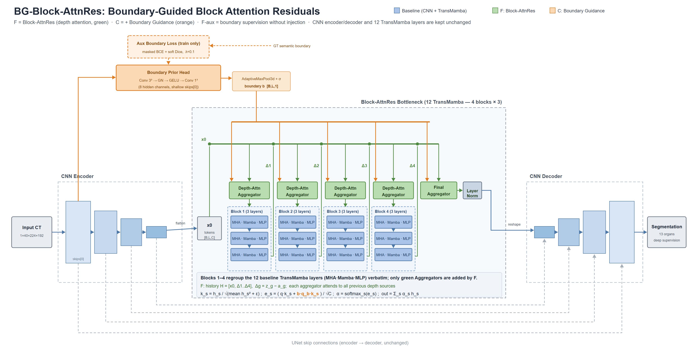

# 基于边界引导深度残差注意力与多尺度自适应跳跃融合的Mamba-Attention混合医学图像分割研究

## 工作计划

> 版本：v1.21；更新日期：2026-10-29。
> 当前进度：阶段一CT基线、阶段二实现和真实数据验收、F/C及F-aux首轮1000轮和同协议外部50例评价均完成。F-aux实测DSC 86.3224%、NSD 90.2659%，四份最终归档OSS回读通过，10月30日20:33调用关机；本次无卡重启补本机备份与独立复核。当前仍在2.5：首轮贡献对照已具备，多种子稳定性确认及机制解释尚未完成。
> 阅读入口：[项目文档导航](项目文档导航.md)。本文件是工作计划主版本；具体路径、阶段任务和记录见第八节。
> 已确认决策：主实验各组统一保留当前官方MHA实现。研究主线仍为两个模块、双模块联合及CT/MR验证；未决实现方案与候选对比方法不得当作已经完成的决定。

### 阅读导航：先看阶段，再看实验编号

| 你想了解什么 | 阅读位置 |
|---|---|
| 现在做到哪里、下一步具体做什么 | 第八节；第四节的阶段二任务2.1–2.5 |
| 两个模块分别研究什么 | 第一节与第三节3.2、3.3 |
| 训练、推理和评价哪些设置保持一致 | 第三节3.5统一实验协议 |
| A/F/C/D/E分别是什么、为什么要比较 | 第五节5.1实验编号与比较关系 |
| 哪些已经完成、哪些是补充或待确认任务 | 第四节各阶段状态；第七节验收清单 |

**编号规则**：“阶段一、阶段二……”表示工作顺序；“2.1、2.2……”表示阶段内任务；“A、F、C……”表示模型配置，不表示阶段或执行次序。F是无边界Block-AttnRes对照，C是你的完整模块一。开发F所需的基础代码属于阶段二2.1，不是另一个研究方向。

**任务标签**：“主线任务”需要在相应阶段完成；“并行收尾”不阻塞模块开发；“补充实验”服务于具体论点；“待确认”保留在计划中，核验或讨论后才确定执行范围。阶段进度以任务和产出判断，不以模型性能必须提高作为机械通关条件。

---

## 一、项目概述

### 1.1 研究背景

Hetero-UNet（NeurIPS 2024）采用CNN编码器与解码器，在瓶颈加入由MHA、Mamba和MLP构成的TransMamba模块。论文默认使用12个TransMamba层，在腹部CT、MR及其他分割任务上进行验证。

论文组件消融显示，部分仅组合Mamba与MHA或MLP的配置低于完整模型；论文讨论了缺少MLP时过度抽象的特征可能影响重建。该观察不能直接证明“任何Mamba与MHA堆叠均会退化”，也不能证明“等权残差是退化根因”。本研究拟检验：边界引导深度聚合与多尺度自适应跳跃融合是否能改善当前基座的小器官和边界分割。

### 1.2 研究目标

- **技术目标**：在已冻结的Hetero-UNet基座上，研究BG-Block-AttnRes与多尺度自适应跳跃融合，评估其独立贡献及联合效果。
- **实验目标**：优先完成腹部CT的完整基线与核心消融，再扩展至腹部MR；统一数据划分、预处理与评价协议。
- **工程目标**：形成可从本地迁移至远程及租用服务器的实验流程，保存代码、环境、配置、权重、日志和逐病例指标。

### 1.3 拟研究的两个模块

| 模块 | 待检验的问题 | 主要证据 |
|---|---|---|
| BG-Block-AttnRes | 边界条件是否使深度聚合更有利于细粒度特征 | 与无边界Block-AttnRes的受控对比、逐器官DSC/NSD、边界分析 |
| 多尺度自适应跳跃融合 | 多尺度跳跃特征的自适应交互是否改善解码 | 仅模块二与联合模型的消融、跨尺度设计对照及资源开销 |

尽量保留CNN编码器、解码器和TransMamba内部主体，控制其他变量。参数、训练预算或网络结构如有改变，应明确记录，不能仅凭“插件式”设计认定增益来源。

---

## 二、研究问题与动机

### 2.0 核心科学问题

> 在当前Hetero-UNet实现的分割架构中，深度特征聚合是否存在影响细粒度重建的瓶颈？边界条件与多尺度自适应跳跃融合能否带来稳定、可复现且开销可接受的改善？

| 层次 | 问题 | 验证方式 |
|---|---|---|
| 现象与机制 | 部分组件组合或更深网络是否出现性能下降，是否与特征聚合相关 | 对齐结构的组件/深度消融，特征范数、梯度统计和边界表现；允许未出现退化 |
| 医学任务适配 | 边界引导是否优于通用深度聚合 | 原始基线、无边界Block-AttnRes、BG版本的直接对比 |
| 协同优化 | 深度聚合与跳跃融合是否互补 | 单模块、联合模块及相关替代方法的对比 |

机制分析支持相关性解释，不能单凭可视化认定因果关系。推广至其他架构或任务属于后续验证目标，未开展相应实验前不作泛化结论。

### 2.1 待检验假设

**假设一：深度聚合可能影响细粒度信息保留。** 标准残差累积与归一化可能改变不同深度特征的贡献。需在当前视觉模型上验证，不能将LLM中的PreNorm稀释结论直接视为医学图像分割中的事实。

**假设二：跳跃特征的语义差异可能影响解码。** 当前代码在各解码层将上采样特征与对应编码层特征拼接；这不是所有编码尺度直接拼接。拟研究多尺度自适应交互与融合，并以独立skip门控等版本区分不同设计的贡献。

### 2.2 已确认的相关工作与候选文献

| 工作 | 已确认信息 | 本研究需进一步核对或验证 |
|---|---|---|
| Hetero-UNet | NeurIPS 2024，CNN与TransMamba混合模型，12层默认配置 | 公开实现与论文描述的一致性、当前远程版本、数据与评估协议 |
| Attention Residuals（Kimi Team / Moonshot AI） | 首版2026-03-16；针对LLM深度聚合，提出Full与Block AttnRes | 分组方式、历史表示、归一化和初始化的准确实现及视觉任务适配 |
| XAttnRes | 首版2026-03-28；跨编码/解码阶段历史池，进行空间对齐与通道投影；报告无skip版本的实验 | 完整论文、作者实现及边界相关设计；迁移Hetero-UNet后的效果 |
| nnU-Net、SegResNet、UNETR、Swin-UNETR、U-Mamba | 传统及相关架构候选基线；U-Mamba包含CNN与Mamba | 选择具体版本并对齐训练和评估，不将U-Mamba标为纯Mamba架构 |
| SAMA-UNet、Mamba-HoME、DAMamba、DM-SegNet、EViM、MambaCAFU、TranSamba、DAMamba-UNet3D、BiSegMamba | 继承自旧计划的待核验候选清单 | 逐项核验名称、论文、年份/会议、数据协议、指标、作者代码及许可；核验前不标为已确认SOTA |

旧稿中SAMA-UNet的85.38%、DM-SegNet的85.44%、参数量及部分会议归属未在本次修订中逐项核实，暂不作为确定事实或比较依据。候选清单也不等于已完成调研或复现。

### 2.3 研究定位

已有XAttnRes将深度注意力残差用于医学图像分割，因此不能宣称首次迁移AttnRes到医学分割。拟研究差异在于TransMamba块之间的边界条件聚合及与跳跃融合的组合；是否构成新的方法贡献，应通过完整文献核对和受控实验判断。避免未经核实断言其他方法“无法解决”“无边界先验”或“增益有限”。

---

## 三、技术方案


> 架构图用于表达方案；实现后需核对张量形状、数据流与实际代码是否一致。

### 3.1 整体架构

- CNN编码器产生不同分辨率特征。
- 瓶颈TransMamba序列保留MHA、Mamba与MLP，研究块间聚合。
- 浅层特征经边界分支、空间对齐与必要的通道投影，作为聚合条件。
- CNN解码器逐级恢复分辨率，研究对应skip的筛选和跨尺度融合。
- 首轮控制TransMamba层数及基础训练配置，避免同时调整多个因素。

### 3.2 模块一：BG-Block-AttnRes

1. 明确AttnRes分组边界、历史池中保存的表示、组内标准残差与组间聚合公式。“一个TransMamba层”与“一个AttnRes分组”不必相同，必须分别定义。
2. 先实现无边界版本，验证形状、前向/反向传播和聚合尺度。
3. 从浅层CNN特征学习边界图，对齐到瓶颈空间；明确边界信息如何改变深度注意力得分。
4. 明确边界学习方案：可用训练集标签生成边界辅助监督，或采用其他可验证方案；规定边界定义、物理间距处理、损失与权重。推理仅使用图像及其特征，不输入真实标签。
5. 查询向量零初始化且其余得分无非零项时，softmax产生等权平均，不是等权求和；如边界项初始非零，则权重未必均匀。检查尺度、门控和梯度，不能仅凭零初始化保证训练稳定。
6. 无边界消融尽量保持相同聚合结构、初始化与预算；额外边界监督可能带来增益，应通过辅助监督/边界注入消融区分来源。

### 3.3 模块二：多尺度自适应跳跃融合

**研究目标保持原方案**：让不同尺度的编码特征以自适应方式参与解码，验证其对小器官与细节恢复的作用。具体跨尺度来源、对齐与融合公式在阶段三设计，不在当前阶段提前锁死。

- **主线设计**：明确哪些尺度参与当前解码层；完成空间对齐、通道投影和动态加权，形成可描述、可检验的多尺度信息交互。
- **基础实现/补充对照**：每条skip独立进行通道与空间门控，可作为开发起点或消融，不能未经说明就取代原多尺度研究目标。
- 参数量和速度目标需要实测。若后续证据支持简化模块，单独记录范围调整及原因，不能自动把多尺度融合降为可选。

### 3.4 技术路线

```text
阶段一：CT基线训练、推理与评估（核心已完成）
    ↓
阶段二：模块一BG-Block-AttnRes（当前阶段；包含基础F与完整C）
    ↓
阶段三：模块二多尺度自适应跳跃融合（D）
    ↓
阶段四：双模块组装与联合调优（E）
    ↓
阶段五：横向对比、消融、MR验证与可视化
    ↓
阶段六：论文撰写
    ↓
阶段七：修改与投稿
```

各阶段产生的实验结果持续归档；阶段五是汇总和补齐证据，不要求把阶段二、三、四已完成的模型重复训练一遍。

### 3.5 统一实验协议 + 基线冻结定义（保留官方 MHA）

> **决策状态：已冻结（2026-10-13）。** 主实验统一保留当前归档的Hetero-UNet官方公开实现中的MHA配置与输入布局，不修正该轴设置。该选择适用于A/F/C/D/E及同基座相关对照，MHA修复不再是进入A/F/C的前置条件。无需仅为这一决定重训现有A。

#### 3.5.1 基线定义与比较范围

**基线A**：本项目已在实验室自行训练、迁移至租机完成外部50例评估的Hetero-UNet实现版本，采用nnunetv2 2.1.1、fold_all、3d_fullres、1000 epochs，保留`MambaUNet.py`中`MHA(hidden_size, mha_head)`的默认`batch_first=False`及实际`[B,L,C]`输入。当前参考结果为DSC 86.7638%、NSD 90.5529%，实际推理加载代码指向`fold_all/checkpoint_best.pth`。

“保留官方MHA”指固定本项目核对并归档的公开实现，不能据此断言论文实验一定使用了完全相同的代码版本。归档代码提交/差异、关键文件哈希、plans与实际权重哈希，作为版本追溯依据。

本组实验回答：**在这个固定实现的基座上，深度聚合、边界条件与跳跃模块能否改善分割效果？** MHA是保持不变的实现规则，不是各组数值相同的参数或输出；新增模块可能与其交互。不得声称该轴问题没有性能影响、单病例推理因此不受影响，或结论已经推广到正确空间轴MHA及所有混合架构。

#### 3.5.2 CT主实验统一协议

| 项目 | 冻结规则 |
|---|---|
| 数据与划分 | Dataset701_AbdomenCT；主训练使用原50例训练集、`fold=all`；外部FLARETs_0001–0050共50例用于最终评估，核对病例无重叠 |
| 调参与选择 | 模块超参和设计选择使用训练集内部固定开发划分；最终主实验按冻结设置使用fold_all。不能根据外部50例反复择优；已开展的外部病例分析如实记录 |
| plans与预处理 | A/F/C/D/E采用相同`plans.json`、`dataset.json`、spacing、归一化、标签映射及数据增强配置；保留主实验版本哈希 |
| 输入与物理batch | `3d_fullres`，patch=`[40,224,192]`，每次前向的物理batch=2；采样规则及前景过采样比例保持一致，记录随机种子 |
| 主体网络 | 保留12层TransMamba及现有MHA配置、轴布局、Mamba/MLP和CNN主体；各组仅按消融表启用对应新增模块 |
| 训练预算 | 1000 epochs；250次训练迭代/epoch、50次训练内验证迭代/epoch；初始学习率0.01，优化器、调度器、损失、深监督、AMP及其余超参沿用归档A配置 |
| checkpoint | 主实验统一选择`checkpoint_best.pth`，采用相同训练内选择规则；fold_all的训练内验证复用训练病例，不能将其分数解释为独立验证表现。不得用外部50例在best/final或多个epoch之间择优 |
| 权重加载 | 允许修复推理入口忽略fold/checkpoint参数的问题，但主实验显式指定`-f all -chk checkpoint_best.pth`，记录并核验实际权重路径；不因此改变MHA计算 |
| 推理 | `eval`模式，逐病例、每次网络前向patch batch=1、关闭TTA，预处理/导出各1进程；固定滑窗步长0.5、Gaussian加权及推理精度设置 |
| 评价 | 同一DSC/NSD脚本、逐器官容差、GT spacing、空标签规则与label 5/6/10的z切片范围；报告全部50例和13器官，不删除低分病例 |
| 导出与后处理 | 统一重采样、标签转换与后处理规则；低内存补丁用于资源适配时归档版本、输入/输出dtype和适用病例，保留与原流程的配对验证记录，不宣称已证明所有输入等价 |

固定的CT推理入口示例（权重选择逻辑修正后使用，INPUT/OUTPUT替换为对应单病例目录）：

```bash
nnUNetv2_predict -i INPUT -o OUTPUT -d 701 -c 3d_fullres \
  -tr nnUNetTrainerMambaUNet -f all -chk checkpoint_best.pth \
  --disable_tta -npp 1 -nps 1
```

MR另行冻结其自身数据、通道和plans；不把CT patch/spacing强行用于MR。其他架构的横向对比统一数据与评价，记录必要的架构适配及训练配置差异，不强行给外部方法加入本基座的MHA实现。

#### 3.5.3 探索与结果确认的区别

实验配置统一见第五节5.1，A/F/C/D/E及同基座G/H保持相同MHA。阶段二的主要研究对象是C，F用于区分无边界深度聚合与边界条件的贡献。

- **探索阶段**：直接复用现有A；实现基础模块、边界分支和完整C，训练F/C进行对照。F与C可以共享代码，通过开关配置，完整训练安排可并行或顺序进行。
- **不设性能门槛**：基础模块的形状、梯度与数值检查通过后即可开发边界分支。F不必先优于A，也不必先完成1000 epochs，才允许开发C。短程试跑验证可运行性，不与A的完整训练结果作性能结论。
- **关键结果确认阶段**：按已冻结协议，A/F/C使用预先记录的同一组至少3个训练种子，报告均值±标准差及逐病例配对分析。这属于后续确认任务，不是当前2.1开工条件。现有A仅在种子与协议可追溯、一致时计入一次；否则补充对应A实验。
- D/E的关键结果重复次数和MR实验矩阵在阶段五登记；不得用A的一次结果代替A的多种子统计。

#### 3.5.4 batch与显存约束

当前MHA沿真实batch维计算，训练batch内是patch样本，不保证来自两个不同病人。各组固定物理batch和采样规则；梯度累积不能替代更大物理batch的前向交互，也不能将某组的batch=1加累积视为等价于主协议batch=2。

显存不足时，先评估不改变前向语义的内存优化或使用更大显存设备，保持batch=2及原patch。参数增量小不代表激活/显存增量小。若确需统一缩patch或更改batch，建立独立协议版本，各相关组按新设置训练和评估；不能直接沿用旧A作为该新协议的主基准。

#### 3.5.5 结论边界与可选修正版

论文中如实说明当前MHA轴设置及训练跨样本交互的实现局限；贡献表述为块间深度聚合、边界条件和跳跃融合在该实现上的效果。不将其写为“增强/修复了空间自注意力”，不预设录用结果或泛化范围。

`batch_first=True`空间轴修正版只作为未来可选补充实验，单独命名与报告；若开展，修正版基线与改进模型均使用相同修正并重新训练。该补充不阻塞当前A/F/C主实验，也不要求现在重训已有A。

---

## 四、详细工作计划：沿用原七阶段

| 阶段 | 核心目标 | 对应配置 | 当前状态 |
|---|---|---|---|
| 一：基线核对、推理补齐与复现验收 | 得到可信、可追溯的CT基线 | A | CT核心实验已完成；归档并行收尾 |
| 二：模块一实现与验证 | 完成BG-Block-AttnRes，区分聚合与边界条件贡献 | F、C，对照已有A | **当前阶段；F/C首轮训练与外评完成，2.5正在执行F-aux贡献归因** |
| 三：模块二实现与验证 | 完成多尺度自适应跳跃融合并单独验证 | D，对照A | 待开展 |
| 四：完整模型组装与调优 | 组合两个模块，分析联合效果 | E，对照A/C/D | 待开展 |
| 五：实验验证 | 补齐横向方法、消融、MR与可视化 | A–H及外部方法 | 待开展；可提前积累资料 |
| 六：论文撰写 | 将已验证的问题、方法与证据写成论文 | 引用前述结果 | 待开展 |
| 七：修改与投稿 | 核对、审阅、按目标要求提交 | — | 待开展 |

阶段三与四独立保留，不再合并；MR与相关方法对比归入阶段五。前面阶段已经得到的结果在阶段五汇总复用，不因换了阶段名称就重新训练。

### 阶段一：基线核对、推理补齐与复现验收

**完成范围**：CT单次1000 epochs训练、外部50例预测、DSC 86.7638%与NSD 90.5529%已完成。可进入阶段二；MR验证不作为当前阶段二开工的前置条件。

| 任务 | 工作及完成情况 | 产出/剩余事项 |
|---|---|---|
| 1.1 环境、数据与训练 | 已完成CT训练；本地权重包内训练日志已核实Epoch 999与Training done | A的权重、训练记录与plans |
| 1.2 大病例推理 | 租机补齐全部50例，0050用低内存导出补丁完成 | 50例预测；用户确认存于OSS |
| 1.3 双指标评估 | 两份CSV各50例×13器官，重算均值及完整性检查完成 | 本地DSC/NSD表及结果分析 |
| 1.4 基线定义 | 已决定保留当前官方MHA，各组采用同一实现；推理代码读取best已核对 | 第三节3.5；此项已关闭 |
| 1.5 并行收尾 | 整理代码/权重哈希、环境记录、OSS清单和日志，核对训练与外部病例无重叠 | 归档索引与实验清单；无需因此重训A或中断本地模块开发 |

论文CT平均DSC/NSD为86.7%/90.5%，MR为84.8%/91.8%。指标接近是复现证据之一，不代表所有器官完全一致或多种子稳定性已确认。fold_all训练内分数不作为独立外部评估结果。

### 阶段二：模块一BG-Block-AttnRes实现与验证（当前阶段）

**目标**：完成你的模块一C，并用F区分“深度聚合本身”与“边界引导”的贡献。F是本阶段的基础版本和消融对照，不是新增阶段或替代研究目标。

| 任务 | 具体工作 | 交付物 | 对应配置/检查点 |
|---|---|---|---|
| **2.1 Block-AttnRes基础实现** | 明确12层TransMamba的分组、历史表示、归一化和聚合公式；实现无边界基础模块，检查初始化幅度、张量形状、前向与反向 | 基础模块代码、接口/形状说明、检查记录 | 接入A后可形成F；此处要求代码与数值正常，不要求先完成F长训练 |
| **2.2 边界先验分支** | 从浅层CNN特征预测边界图，明确训练监督、边界定义、损失权重及瓶颈对齐；推理不输入GT | 边界分支代码与监督/对齐说明 | C的边界部分；可与2.1后半段并行设计 |
| **2.3 BG版本组装** | 将边界条件接入深度聚合，保留F/C切换配置；检查完整网络、梯度和资源占用 | 完整模块一C、独立Trainer或等效配置、短程运行记录 | 形成F与C两种配置；MHA与基础协议保持冻结 |
| **2.4 模块有效性验证** | 先在开发划分验证，与2.5迭代并冻结方案后，按3.5节完整训练F/C、评估全部50例DSC/NSD，比较A/F/C | 模块一对照表、日志、权重与资源记录 | C对A看整体效果，F对A看聚合效果，C对F看边界条件增益 |
| **2.5 调参与结果确认** | 训练前：仅在开发划分选择模块超参并冻结；训练后：按冻结种子协议确认关键结果，区分辅助监督与条件注入的贡献 | 最终模块一配置、重复实验计划/结果、必要控制消融 | 开发集调参先于最终外部评估；多种子确认随后补齐，不要求2.1开工即完成 |

**执行规则**：2.1基础模块检查通过后即可继续2.2/2.3，F不必先优于A。F与C可共享代码，训练顺序按资源安排，不强制先等F训练完1000 epochs才开发C。短程试跑用于查错和测资源，不用于与完整训练A作最终性能结论。

**验证与调参的实际顺序**：2.1–2.3实现 → 2.4/2.5在开发划分迭代 → 冻结配置 → 完整训练与外部50例评估 → 补齐关键结果统计。2.4、2.5表示任务归属，不要求把2.4所有外评做完才开始调参；外部结果不用于反复选择超参。

**阶段产出**：完整C、可运行F、A/F/C对照及可追溯配置。若C无稳定收益，应记录负结果、检查设计与实现，再调整方案；不把F单独无增益当作否定边界引导的结论。0.3个百分点只作初步分析参考，不是机械通关线。

BG-Block-AttnRes 结构示意图（编码/解码尺度为简化绘制，实际尺度、步幅和patch以冻结plans为准）：



- **灰蓝 = 基线（保持不变）**：CNN 编码器 → 瓶颈 12 个 TransMamba（每块 MHA・Mamba・MLP 三子层）→ CNN 解码器；实际尺度由 plans 决定；底部灰虚线是 UNet skip 连接。
- **绿色 = F（Block-AttnRes）**：12 层按 block_size=3 分成 4 组，每组一个 **Depth-Attn Aggregator** + 一个 **Final Aggregator**（共 5 个）；顶部绿色总线是历史 `H=[x0,Δ1..Δ4]`，每个聚合器只对**深度源**做 softmax，每组输出残差 `Δg=z_g−a_g` 回灌历史。
- **橙色 = C（Boundary Guidance）**：从编码器最浅层 `skips[0]` 经 **Boundary Prior Head**（Conv3³→GN→GELU→Conv1³）→ MaxPool+σ 得到边界图 `b`，注入每个聚合器；**实线 = 前向数据流（推理也参与）**，**虚线 = 仅训练时的辅助监督**（Aux Boundary Loss，masked BCE+soft Dice，λ=0.1，来自 GT 语义边界）。
- 底部公式框给出聚合器完整公式，边界项 `b·q_b·k_s` 用橙色高亮，与代码 `DepthAttentionAggregator` 逐行一致（RMS key、softmax over sources、零查询初始等权）。

**F/C/F-aux 三种配置在图上的对应**：F = 只保留绿色；C = 绿 + 橙（注入 + 辅助监督）；F-aux = 绿 + 橙虚线（有监督、**去掉橙色注入实线**）。

### 阶段三：模块二多尺度自适应跳跃融合实现与验证

**目标**：保持原多尺度研究目标，验证模块二单独使用的效果，不提前叠加模块一掩盖贡献。

| 任务 | 具体工作 | 交付物/配置 |
|---|---|---|
| 3.1 结构设计 | 明确尺度来源、空间/通道对齐、融合位置与动态权重；简单skip门控仅作基础版本或对照 | 多尺度模块设计与张量流说明 |
| 3.2 实现与嵌入 | 接入原A的skip路径，检查前向/反向、初始化及显存 | 仅模块二模型D |
| 3.3 独立验证 | 同协议训练D，与A对比，必要时比较独立skip门控与真实跨尺度版本 | A/D对照及模块二最终配置 |

**阶段产出**：D及其独立贡献证据。若收益有限，先分析再讨论是否简化，不自动删除多尺度目标。

### 阶段四：完整模型组装与调优

| 任务 | 具体工作 | 交付物/配置 |
|---|---|---|
| 4.1 双模块组装 | 在同一基座同时启用BG模块与多尺度跳跃融合，检查接口、损失与资源兼容 | 完整模型E |
| 4.2 联合调优 | 在开发划分调整新增模块的配置，比较是否互补或冲突，保持主协议公平 | 联合配置与调优记录 |
| 4.3 完整验证 | 对比A/C/D/E，确认联合收益和开销；安排关键结果重复实验 | 最终候选模型、联合消融与权重 |

**阶段产出**：完整模型E与联合分析。允许联合模型无额外收益，据实说明，不预设一定优于两个单模块。

### 阶段五：实验验证（横向对比、消融、MR与可视化）

| 任务 | 具体工作 | 产出 |
|---|---|---|
| 5.1 文献与横向方法核验 | 保留原候选清单，核对论文/代码、数据协议及可运行性，登记正式实验范围 | 同协议横向对比矩阵；待确认项明确标记 |
| 5.2 消融汇总与补充 | 复用A/F/C/D/E结果，开展定义明确的B及直接相关G；H与其他补充按论点和预算确认 | A–H结果或未执行理由；不将候选直接写成已完成 |
| 5.3 MR跨模态验证 | 准备Dataset702、核对通道和plans；登记并开展基线与方法验证，决定必要消融和重复次数 | MR的DSC/NSD、配置及跨模态结果 |
| 5.4 关键结果确认 | 核对同种子统计、病例配对和所有实验版本，补齐缺少的重复实验 | 均值/标准差、配对分析、完整结果表 |
| 5.5 可视化与误差分析 | 预先登记选例规则，展示边界、小器官与失败样例，按权重维度制作聚合分析 | 分割图、边界图、权重分析与失败说明 |
| 5.6 效率分析 | 统一硬件、精度、patch及TTA，记录参数、耗时、显存、主机内存和算子统计覆盖 | 效率表及适用条件 |

MR主验证与原横向候选目标保留；具体方法版本、MR组数和资源预算需形成清单，未完成核验不等于取消该目标。可提前准备资料，但不要求把阶段五所有方法先跑完才能开发阶段二。

### 阶段六：论文撰写

| 任务 | 具体工作 | 交付物 |
|---|---|---|
| 6.1 问题与相关工作 | 用已有文献和实验区分事实、假设与贡献，准确讨论相关工作 | Introduction、Related Work草稿 |
| 6.2 方法与实验 | 描述两个模块、统一协议、对比、消融与效率，明确MHA实现范围 | Method、Experiments及图表 |
| 6.3 讨论与结论 | 据实解释正负结果、局限和泛化范围，完成摘要与结论 | 论文初稿 |

### 阶段七：修改与投稿

| 任务 | 具体工作 | 交付物 |
|---|---|---|
| 7.1 一致性核查 | 核对论文数字、代码版本、图表与结果来源，完成内部审阅 | 修改稿与检查记录 |
| 7.2 投稿准备 | 确认当年目标会议/期刊要求、格式、截止时间和补充材料 | 投稿材料 |
| 7.3 提交与记录 | 按实际确认的目标提交，归档版本与后续反馈 | 提交记录 |

---

## 五、实验配置与对比设计：字母是模型，不是阶段

### 5.1 A–H配置及比较关系

| 配置 | 模型含义 | 主要研究阶段 | 比较目的与任务性质 |
|---|---|---|---|
| A | 已冻结的Hetero-UNet | 阶段一已得到，后续复用 | 主基线；多种子确认另行补齐 |
| B | 定义明确的Mamba+MHA组件对照 | 阶段五 | 原动机对照保留；明确是否去掉MLP等差异，不预设一定退化 |
| C | A + BG-Block-AttnRes | **阶段二的主要目标** | C对A看模块一效果；C对F区分边界条件贡献 |
| D | A + 多尺度自适应跳跃融合 | 阶段三 | D对A看模块二独立贡献 |
| E | A + 两个模块 | 阶段四 | 与A/C/D比较联合效果 |
| F | A + 无边界Block-AttnRes | 阶段二基础实现/对照；阶段五汇总 | 原计划已有；F对A看通用聚合，不作为开发C的性能门槛 |
| G | A + XAttnRes适配版本 | 阶段五 | 原直接相关对比目标保留；实现细节需核验 |
| H | A + XAttnRes适配版本 + 模块二 | 阶段五 | 原协同对照保留；具体运行预算和必要性待确认，不自动删除 |

B不是等权残差缺陷的直接证明；需记录模块顺序、层数、归一化和参数/训练预算。C对F若同时增加辅助边界监督，还需控制监督项的独立贡献。

### 5.2 横向对比清单与范围状态

| 类别 | 保留的原候选方法 | 当前任务 |
|---|---|---|
| CNN参照 | nnU-Net、SegResNet | 核对具体版本与同数据/评价配置 |
| Transformer参照 | UNETR、Swin-UNETR | 核对3D任务适配与训练设置 |
| 相关基座 | U-Mamba、Hetero-UNet | 对齐任务；U-Mamba为CNN与Mamba混合，不标纯Mamba |
| 直接相关聚合 | 无边界Block-AttnRes、XAttnRes | 保留与核心贡献直接相关的比较 |
| 近期候选 | SAMA-UNet、Mamba-HoME、DAMamba、DM-SegNet、EViM、MambaCAFU、TranSamba | 逐项核验论文、作者代码、数据协议、指标与开源状态 |
| 补充文献候选 | DAMamba-UNet3D、BiSegMamba等原文献清单 | 作为调研对象保留，核验后判断是否需要实现 |

**范围规则**：原计划“12–14个基线”保留为早期规模参考，不是已经完成或不可改变的最终数量。候选名单不因优先级整理被删除；正式哪些必须复现、哪些引用、哪些不适配，需在阶段五任务5.1中逐项核验并记录依据。先核心证据、再扩展方法只是排程建议，不代表研究方向变化。

同一数据集名称也须核对病例划分和器官标签。BTCV、Synapse与本项目Abdomen的论文数字不能直接排名；不同协议的引用结果另表标注，不混为同协议实测。

### 5.3 必要控制与补充实验

- **核心证据**：A/F/C、A/D、A/C/D/E，及与直接相关聚合方法的公平比较。
- **随设计落实的控制项**：边界辅助监督与边界注入的贡献；多尺度交互与独立skip门控的区别。具体控制组在设计时登记。
- **补充实验**：边界引导权重、TransMamba层数、AttnRes分组大小、Full/Block资源对比、边界条件移除或扰动；按实际论点选择。
- **未来可选项**：空间轴MHA修正版；按3.5.5单独报告，不阻塞当前主线。

### 5.4 结果展示与解释规则

- 报告平均与逐器官DSC、NSD，提升用“百分点”；固定容差、spacing、空标签与z裁剪规则。
- 同时展示预先确定的困难病例和失败样例，不仅展示有利结果。零分需要结合GT/预测体素与交集解释。
- 注意力可视化匹配权重形状：全局深度权重说明层贡献，空间热图需实际位置相关权重；热图本身不证明因果。
- 参数、速度、显存与主机内存统一测量条件；FLOPs说明自定义算子的覆盖范围，不将缺失统计当完整复杂度。
- 不预设本文一定优于所有模型；参数效率、小器官和边界优势都以结果为准。

---

## 六、执行安排、算力与风险

### 6.1 近期顺序与工期

| 顺序 | 阶段/任务 | 执行说明 |
|---|---|---|
| 已交付 | **阶段二2.1、2.2、2.3** | F/C/F-aux、边界损失、69项测试；真实CUDA与真实数据短程、best加载和单病例导出通过 |
| 已完成 | 阶段二2.4首轮A/F/C对照 | F/C均完成1000轮及同协议外部50例DSC/NSD，原始结果与备份已核验 |
| 已完成 | 阶段二2.5：F-aux首轮贡献对照 | 1000轮、同50例DSC/NSD、A/F/F-aux/C对比与四份OSS归档回读通过 |
| 随后 | 阶段二2.5：关键结果确认 | 按F/F-aux/C结果决定后续内部开发检查，补齐关键组相同种子集合的重复实验 |
| 后续 | 阶段三、四 | 开发D、组装E，各自独立验证 |
| 汇总 | 阶段五 | 复用前面结果，补横向方法、MR、必要消融与分析 |
| 并行收尾 | 阶段一1.5 | 哈希、OSS与日志归档；不代替或阻塞本地2.1开发 |

原17周安排仅作早期参考，不能据此推算确定剩余工期。按各完整训练/推理实测GPU小时、重复次数、迁移与重试预算重新排期；不要未经测量承诺固定天数完成全部对比。

### 6.2 下一次租机执行流程

1. 本地先准备好代码、阶段任务对应的配置、命令、数据清单和记录模板，再开机部署。
2. 核验实际导入路径、依赖、plans与权重；保持3.5节的物理batch、patch和MHA设置。
3. 先做短程训练与显存检查；推理验收一个小病例和一个最大病例，再批量运行。
4. 预处理/导出并发各1；不需要时不存概率图。导出OOM针对主机内存、重采样与队列处理，不随意改训练输入。
5. 若改patch、batch、TTA、精度或checkpoint规则，登记独立协议版本；按3.5节判断相关组是否需重新训练/评估，不混用旧结果。
6. 记录参数、GPU/主机内存峰值、训练和病例推理耗时；实例配置根据实测确定。
7. 将预测、权重、补丁、环境与日志同步到持久存储，检查可读性后再关机。不要把临时数据盘当长期备份。

### 6.3 风险与处理

| 风险 | 已知状态 | 处理方式 |
|---|---|---|
| MHA实现局限 | 统一保留的决策已完成 | 固定物理batch和协议，限定结论；不重新设为阶段二阻塞项 |
| F不提升 | 可能发生 | 检查实现并继续检验边界条件；不据此禁止开发C |
| C或D/E收益不稳定 | 待实验 | 分析多种子、逐病例及资源开销，记录负结果，讨论后再调整范围 |
| 边界收益来源混淆 | 辅助监督与条件输入可能同时变化 | 设置控制消融，明确监督与注入的作用 |
| 权重/评价/划分混用 | best硬编码与fold_all内部验证已知 | 记录实际加载，统一选择规则，区分开发与外部评价 |
| 大病例内存不足 | CT导出瓶颈已定位并处理 | 保存补丁与验证记录，统一导出协议，测主机内存 |
| 文献或数据协议错误 | 近期候选仍需核验 | 查作者论文/代码，不凭旧表数字做排名或删除候选 |
| 工期与预算扩大 | 多种子、MR及横向方法会增加成本 | 分阶段安排，保留目标与候选，明确待确认范围 |

---

## 七、预期成果与验收指标

### 7.1 探索目标（非已实现结果）

| 指标 | 初始目标 | 判断依据 |
|---|---|---|
| 平均DSC | 相比核对后的基线提升0.5-1.0个百分点 | 同协议、多种子结果 |
| 重点小器官DSC | 提升1.0-2.0个百分点 | 预先确定器官，报告所有器官结果 |
| NSD | 稳定改善 | 固定容差与空间信息 |
| 参数增量 | 小于5% | 实际模型统计 |
| 推理速度下降 | 小于10% | 相同硬件与输入条件实测 |

未达到目标时据实报告；不通过更换测试集、选择有利种子或省略失败病例制造提升。

### 7.2 分阶段验收清单

**阶段一：CT核心已完成，归档并行收尾**

- [x] CT 1000 epochs自行训练与权重保存；训练日志已核实。
- [x] 外部50例全部推理，DSC/NSD各50例×13器官已得到并复核。
- [x] 本地/远程MHA设置已核对，统一保留决定已冻结。
- [x] 用户确认权重/CSV/文档/脚本在本机，预测和低内存补丁在OSS。
- [ ] 阶段一1.5：代码/权重哈希、环境、OSS路径/完整性、日志与病例清单归档。

**阶段二：实现与短程验收、F/C首轮训练及外评完成；F-aux和关键结果确认进行中**

- [x] 2.1基础Block-AttnRes代码、接口及CPU前向/反向检查；12层按3层分组、历史残差增量、RMS keys与零查询初始化已记录。
- [x] 2.2边界分支与监督/对齐方案；语义边界、ignore mask、BCE+Dice及瓶颈池化已实现。
- [x] 2.3本机部分：完整C与F/F-aux独立Trainer、运行入口；65项测试和6组CPU框架诊断通过。
- [x] 2.3服务器部分：真实Mamba CUDA/AMP、完整patch物理batch=2真实数据短程、显存、best/final及单病例推理导出验收。
- [x] 2.4首轮A/F/C对照与逐器官指标；F/C各1000轮、同50例DSC/NSD、逐病例配对及结果备份完成。
- [ ] 2.5贡献确认：F-aux完整训练与同协议评价已完成；关键结果的相同种子集合重复实验待补。后续新方案仅在内部开发划分选择。

**阶段三至五：后续主线与证据**

- [ ] 阶段三：多尺度模块D及A/D验证。
- [ ] 阶段四：联合模型E及A/C/D/E分析。
- [ ] 阶段五：横向候选核验与正式比较清单、B/G及H执行范围登记。
- [ ] 阶段五：MR主验证与对应实验矩阵。
- [ ] 阶段五：关键结果统计、边界/失败样例、效率及必要补充分析。
- [ ] 文献和代码来源、实测与引用结果明确区分。

**阶段六、七：写作与提交**

- [ ] 论文初稿、图表与数据来源一致。
- [ ] 审阅、格式、目标要求核对及投稿归档。

---

## 八、当前进展与下一步行动

### 8.1 当前定位（2026-10-29）

**阶段一CT核心完成；阶段二2.1–2.3实现与服务器短程验收完成；2.4首轮F/C均完成1000轮及外部50例统一评价，现处于2.5，首轮错误分层与边界引导诊断已完成，贡献确认仍待推进。** C于10月24日15:57完成从头训练，best为第994轮、final为第1000轮；训练、内部验证和边界损失记录各1000条且均有限，权重及OSS备份已独立复核。F从4090第500轮完整检查点迁移，已累计完成1000轮；源码、原预处理、优化器和best规则保留，随机增强worker状态不能逐位恢复，跨硬件训练记录须如实报告。已有A的DSC 86.7638%、NSD 90.5529%；MHA保留决策已完成，现有A可作探索基准。训练完成尚不等于模块有效性验收，当前不因此进入阶段三。

**当前收尾（10月30日）**：F-aux从随机初始化完成1000轮，best/final均为第1000轮；训练、验证及边界损失各1000条且有限。外部50例DSC 86.3224%、NSD 90.2659%，相对F为−1.2844/−0.9618个百分点，相对C更低。四份最终归档已上传OSS并回读通过，20:33自动关机调用返回。用户无卡重启后，本机四份最终归档、包内best/final及50份预测已独立核验；补充报告和复核证据上传回读通过后，于23:37再次调用关机返回0，随后SSH不可达。首轮结果不能证明辅助监督必然有害或注入普遍有效，不以外部结果直接调参。

研究目标仍为BG-Block-AttnRes、多尺度自适应跳跃融合、联合模型及CT/MR验证。归档与候选方法核验有未完成事项，但不因此改变当前阶段定位。实验配置含义统一查第五节5.1。

### 8.2 接下来的一轮工作

| 顺序 | 工作 | 本轮完成标准 |
|---|---|---|
| 已交付 | 阶段二2.1–2.3 | F/C/F-aux、69项测试、真实CUDA/AMP、真实数据短程及检查点推理通过 |
| 已完成 | 阶段二2.4：F首轮长训练 | 10月22日21:05累计完成1000轮；best/final、日志及配置已上传OSS并回读校验，并另存本机；当次自动关机为历史安排 |
| 已完成 | 旧4090项目完整保存与释放验收 | 1,091文件、约33.76GB已在V100逐文件SHA256通过，缺失0，OSS收据回读通过；原始数据、A基线、旧代码及短程权重已补齐，可释放旧机 |
| 已完成 | 数据盘历史整理与扩容 | 10月22日在50GB盘清理已验证重复文件；10月29日已扩至150G，F-aux启动时可用约131G；原始数据和A/F/C结果保留 |
| 已完成 | 阶段二2.4：C首轮长训练 | 10月22日23:23至24日15:57在V100从头完成1000轮，seed1234、原patch/batch/MHA；best994/final1000有效，OSS三份归档回读和12份结果文件逐项匹配通过；当时保持开机；最新关机安排以评价收尾授权为准，不自动接续其他训练 |
| 已完成 | 阶段二2.4：F/C外部50例评价与汇总 | 两组best、同协议50例DSC/NSD、逐器官/逐病例配对结果及OSS备份核验齐全 |
| 本轮诊断完成 | 阶段二2.5：错误类型与边界引导功能诊断 | 全50例空类/非空类、TP/FP/FN与叠图；五个代表病例patch上检查边界图、池化引导、深度权重及固定C权重的引导干预。仅诊断、不调参、不将推理时关闭引导当作F-aux |
| 已完成 | 阶段二2.5：F-aux首轮贡献对照 | best/final1000、50例评价、四组汇总与OSS四包回读均通过；本机补备份后再次关机 |
| 待确认 | 阶段二2.5：关键结果稳定性 | F-aux结果归因后按冻结种子集合安排重复实验；若改方案，先做内部开发验证并单独登记版本 |
| 并行收尾 | 阶段一1.5归档 | 补代码/权重哈希、OSS清单、环境与日志路径 |

**最近交付物**：阶段二实现与真实数据验收、F/C首轮训练和外部50例评价、全50例错误分层和五例引导诊断，以及F-aux启动核验。当前关机授权对应10月29日F-aux的完整训练→评价→归档回读流程；10月24日C评价收尾属于已完成历史。F是无边界基础对照，C是完整模块一；附加F-aux只有边界监督、没有注入，用于区分监督贡献。原A–H矩阵、F/C比较要求和模块二方向均未改变。

- [实现设计与当前边界](Hetero-UNet/docs/stage2/README.md)
- [逐文件修改与本机验证记录](Hetero-UNet/docs/stage2/CHANGELOG.md)
- [服务器拉取、CUDA短程检查、训练与外评操作](Hetero-UNet/docs/stage2/SERVER_RUNBOOK.md)
- [F-aux完成核验与四组结果](Hetero-UNet/docs/stage2/FAUX_COMPLETED_2026-10-30.md)
- [F-aux训练、评价及自动归档关机](Hetero-UNet/docs/stage2/FAUX_TRAINING_2026-10-29.md)
- [F/C错误类型与边界引导诊断](Hetero-UNet/docs/stage2/DIAGNOSTICS_2026-10-29.md)
- [评价汇总、备份及自动关机](Hetero-UNet/docs/stage2/EVALUATION_SHUTDOWN_2026-10-24.md)
- [F/C外部50例评价执行记录](Hetero-UNet/docs/stage2/F_C_EVALUATION_2026-10-24.md)
- [C训练完成、独立核验与后续评价](Hetero-UNet/docs/stage2/C_COMPLETED_2026-10-24.md)
- [C正式训练、日志与自动备份（保持开机）](Hetero-UNet/docs/stage2/C_TRAINING_2026-10-22.md)
- [F训练完成与数据盘整理历史记录](Hetero-UNet/docs/stage2/F_COMPLETED_STORAGE_2026-10-22.md)
- [第500轮迁移、4090完整保存的历史记录](Hetero-UNet/docs/stage2/MIGRATION_2026-10-22.md)

早期CPU诊断使用显式Mamba替身；现已完成真实CUDA、完整CT短程和F/C首轮外部DSC/NSD评价，稳定增益与监督/注入独立贡献仍待F-aux及重复实验确认。首轮预先固定组大小3、边界隐藏通道8、辅助权重0.1，不宣称经过调参或已最优；F/C均保持原MHA。

### 8.3 计划变更规则

- 事实错误直接纠正并留下版本记录；既定研究方向和MHA协议按本计划执行。
- 阶段次序、模块二范围、候选方法删减等实质改变，要单独写明建议、依据和是否已确认，不能混在事实纠错中静默实施。
- v1.7恢复原七阶段和多尺度模块目标；历史版本中的合并阶段/可选多尺度安排不再作为当前执行依据。

---

## 九、资料来源与更新记录

- Hetero-UNet原论文：`E:/文献阅读/医学/Hetero-UNet.pdf`，重点核对第5-6页训练/指标和第8-9页消融讨论。
- 本地代码：`E:/PycharmProjects/Hetero-UNet/Hetero-UNet/`；远程相同MHA设置与固定checkpoint_best加载已在2026-10-13核实。
- [Attention Residuals，arXiv:2603.15031](https://arxiv.org/abs/2603.15031)，首版2026-03-16。
- [Moonshot AI官方实现](https://github.com/MoonshotAI/Attention-Residuals)。
- [XAttnRes，arXiv:2604.03297](https://arxiv.org/abs/2604.03297)，首版2026-03-28。

*创建日期：2026-09-09。*

*v1.4（2026-10-09）：修正文献日期、论文动机和初始化表述；将未经验证的机理/优势改为假设；近期候选方法信息待逐项核验；纠正跨数据集比较、U-Mamba分类、skip融合及注意力可视化表述；更新远程训练和推理进度；新增代码/权重/划分核对、租机流程与核心实验优先级。*

*历史版本：v1.3（2026-09-14）扩展相关方法与消融；v1.2（2026-09-14）增加科学问题；v1.1（2026-09-12）扩展对比计划。历史记录描述旧版规划，不代表其事实或实验结论已经核实。*

*v1.5（2026-10-13）：同步自行训练、完整CT双指标及SSH核验进度，明确归档与主研究基线尚待完成；先CT核心对照，再扩展MR及相关方法。*

*v1.6（2026-10-13）：新增3.5节“统一实验协议 + 基线冻结定义（保留官方 MHA）”，主实验统一保留当前官方实现，正式关闭MHA基线定义卡点；冻结CT训练、推理、评价、batch与checkpoint规则，区分现有A复用和关键组多种子确认，将空间轴修正版列为可选补充；同步修改阶段任务、风险、验收清单和近期行动。*

*v1.7（2026-10-13）：为便于阅读与执行重排文档；恢复原七阶段和模块二多尺度目标，新增阅读导航/编号规则；阶段二以2.1–2.5明确任务、产出及F/C对应关系，取消F必须先提升的隐含门槛；实验配置和横向候选集中列于第五节，待核验不等于删除；修正已完成CT结果在验收清单中仍未勾选的问题，区分归档收尾、当前交付物与后续确认；保留v1.6的MHA冻结决策。*

*v1.8（2026-10-14）：落实阶段二2.1/2.2和2.3本机代码，新增F/C/F-aux独立Trainer、边界监督、分组深度聚合及种子/协议/运行记录入口；记录65项单元测试与6组CPU框架诊断通过，并明确真实CUDA、显存及完整实验待验收。修复推理fold/checkpoint硬编码和新版Torch调度器兼容性，原A网络/Trainer/MHA保持不变。链接实现说明、修改记录与服务器手册；七阶段、模块二方向及A–H矩阵不变。*

*v1.9（2026-10-21）：保留用户新增架构图说明；记录新恒源云实例数据/权重/旧预测/补丁恢复、原plans预处理、路径环境变量覆盖修复、69项测试及真实CUDA/真实数据短程和单病例导出通过；同步F/C首轮1000 epochs后台队列与固定协议。尚未完成外部评价和关键多种子确认，未修改研究方向或MHA。详见Hetero-UNet/docs/stage2/SERVER_SESSION_2026-10-21.md。*

*v1.10（2026-10-21晚）：按用户决定只运行F，本组完成后备份校验并关机，C等待更便宜实例单独运行；暂停原接续队列而保留F进程，部署F-only控制及收尾，24项安全测试与Linux模拟队列/OSS回读探针通过。用户已刷新OSS授权至10月22日19:42北京时间。只调整算力执行安排，不改研究方向、A–H矩阵或F/C冻结协议。原v1.9本机备份位于output/document_backups/，用户架构图说明继续保留。*

*v1.11（2026-10-22）：F完成500轮后迁至V10032GB，用原源码、精确预处理与完整优化器检查点续训至累计1000轮；新机完整CUDA及首轮真实训练/验证通过，保留跨硬件/随机状态恢复限制。用户明确不再使用4090，已完成完整目录清点、缺失文件补备份及1,091文件逐文件核验，缺失0、OSS收据回读通过，可释放旧机；后续操作转至V100，C不自动启动。修正协议说明中的plans SHA256笔误，不修改实际plans。v1.10本机备份位于output/document_backups/，保留用户架构图。*

*v1.12（2026-10-22晚）：F累计1000轮训练完成，best/final、审计包和收据OSS上传回读通过；无卡启动后再次CPU加载F权重、核对14项源码指纹、1,091份旧项目文件和19个OSS恢复对象。经用户授权清理19个冗余大文件，释放17.18GiB，保留原始CT/预处理/A/F当前结果，现可用约33.0GiB；F完整包下载本机并核对SHA256。外部50例评价尚未执行，C仍暂缓。v1.11本机备份位于output/document_backups/，用户架构图保留。*

*v1.13（2026-10-22 23时）：用户启动GPU并要求进行C。原预处理253文件、14项源码指纹、完整CUDA/AMP及物理batch2检查通过；C于23:23从随机初始化开始1000轮，seed1234，不加载F权重，边界监督/注入和0.1损失权重按原冻结方案启用。首轮训练/验证及边界分量正常，按原协议单独归档日志、配置、权重和收尾收据；只C完训后上传回读并关机，F-aux不接续。启动时OSS授权早于预计完训，需在10月23日晚或10月24日上午刷新，以覆盖自动上传关机窗口。外部50例评价仍待补齐，研究方向和A–H矩阵不变。v1.12本机备份位于output/document_backups/，用户架构图保留。*

*v1.14（2026-10-22 23:36用户变更）：C完训后只自动上传和回读校验，不关机。旧关机会话已通过取消标记退出，阻断文件保留；新备份进程不携带关机授权参数，配置显式shutdown_authorized=false，误加授权会被拒绝。20项安全测试通过，训练不受中断；最新代码、策略凭据与工作计划另行上传OSS。v1.13本机备份位于output/document_backups/，研究协议及数据未变。*

*v1.15（2026-10-24）：C于15:57完成从头1000轮，best994/final1000；1000轮训练、验证、边界损失均有限，两份权重CPU加载通过，14项源码及描述符指纹与F一致。自动备份15:59完成，本次再从OSS下载三份归档并逐项核验结果包12个文件；完整权重包另存本机、SHA256一致，服务器保持运行。新增C完成记录与独立复核凭据，当前阶段保持二2.4，下一项明确为F/C外部50例统一DSC/NSD，不以内部loss或完训本身认定改进有效。研究方向、A–H矩阵、MHA冻结与超参均未变。v1.14备份位于output/document_backups/，保留用户架构图。*

*v1.16（2026-10-24 17:16）：按用户授权，在C本机完整备份及工作计划记录完成后启动F→C外部50例评价队列；各自best、无TTA、滑窗0.5、相同低内存导出和DSC/NSD规则，NSD限2进程以控制内存。独立推理runtime保留原MHA及模型源码，4组重采样检查分割/概率逐元素一致；每组预测、逐病例/逐器官CSV、日志自动归档OSS并回读，保持开机。v1.15本机备份保留，研究方向和实验矩阵不变。*

*v1.17（2026-10-24晚）：用户授权C评价完成、记录及数据归总后关机。F外部50例评价已完成，C接续运行；独立收尾程序等待两组退出、再次核验预测和CSV、生成A/F/C总体/逐器官/逐病例配对汇总。恒源云拒绝单独JSON上传，改用四份TAR归档并全部回读核验，成功后调用已核验平台关机程序；失败重试并保持开机。10项隔离测试通过。原推理进程、模型与MHA协议均不改，历史无关机授权快照保留。v1.16本机备份留存。*

*v1.18（2026-10-29）：按用户授权启动全50例F/C错误分层、代表病例叠图及五例C边界/池化/深度聚合权重诊断。服务器数据盘已扩为150G；使用原best和模型源码，不训练、不改变MHA或主指标。F/C评价及四份结果归档已在10月24日完成；诊断用于明确下一步，F-aux保留但暂缓。v1.17本机备份留存，研究主线与A–H矩阵不变。*

*v1.19（2026-10-29）：按用户明确授权启动F-aux从头1000轮、同协议外部50例推理评价与A/F/F-aux/C贡献归因；新增独立后台全流程，归档权重、预测、源码和日志，全部OSS回读通过后关机。原训练仓库保持9fe70ac且未改模型；253份预处理、14项源码、外部50例指纹和完整尺寸CUDA/AMP及无注入检查通过。记录OSS授权到期与刷新窗口，上传失败保留结果重试。v1.18已另存备份，原研究方向和A–H矩阵不变。*

*v1.20（2026-10-29）：统一文档入口与目录职责；修正阶段总表、近期顺序、验收清单中仍写F/C外评待做的旧状态，明确F-aux与多种子确认尚未完成；数据盘更新为150G并标注观测时间。保留用户架构图，修正其本机绝对路径并说明简化尺度以plans为准。日期记录和output重复副本明确历史范围，原始日志/收据/权重及训练执行保持不变。修改前文件与SHA256清单另存output/document_backups/document_cleanup_2026-10-29/。*

*v1.21（2026-10-30）：F-aux完成1000轮及统一50例评价，best/final1000；DSC 86.3224%、NSD 90.2659%，独立复算和预测哈希核验通过。四份OSS归档回读后20:33调用关机，用户无卡重启供本机备份复核；首轮贡献对照完成，但多种子和机制结论仍待确认。原协议、MHA与研究方向不变。*
